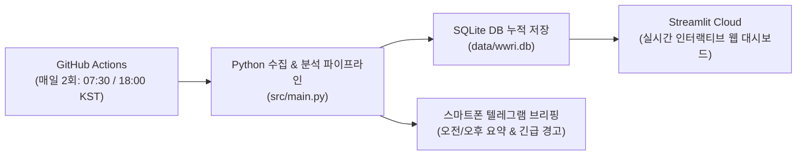

# 🌐 WORLD WAR RISK MONITOR (WWRI)

> **전쟁 위험 추적 및 모니터링 시스템**  
> 단편적인 뉴스에 의존하지 않고, **매일 동일한 기준으로 금융·지정학·군사 데이터를 누적**하여 1·3·6개월 전과 비교 분석하고 위험을 조기 감지하는 자동화 모니터링 시스템입니다.

---

## 🏗️ 시스템 아키텍처



* **서버 유지비:** **0원 (완전 무료)**
* **PC 전원:** 집 컴퓨터가 꺼져 있어도 클라우드 상에서 365일 자동 동작

---

## 📊 위험지수 산정 기준 (WWRI - 100점 만점)

| 영역 | 비중 | 주요 관찰 지표 |
| :--- | :---: | :--- |
| **1. 실제 무력충돌 및 확전** | **30%** | 동유럽·중동·대만해협·한반도 등 분쟁 지역 충돌 빈도 및 사상자 |
| **2. 군사적 동원 및 배치** | **25%** | 병력 이동, 대규모 연합훈련, 군사 동원령 및 전략 무기 전진 배치 |
| **3. 지정학적 위험지수** | **20%** | GPR 지수(지정학적 위험 지수) 및 국제 분쟁 보도 집중도 |
| **4. 금융·에너지 시장** | **15%** | 국제유가(WTI), 안전자산(금), 달러 인덱스, VIX 공포지수 |
| **5. 방위산업 및 군수생산** | **10%** | 글로벌 방산주(LMT, RTX, GD 등)의 시장(S&P 500) 대비 초과 수익률 |

### 위험 수준 판정
* `0 ~ 19점`: **안정** (평온 상태)
* `20 ~ 39점`: **관심** (특정 지표 변동성 주의)
* `40 ~ 59점`: **주의** (복합 위험 신호 감지)
* `60 ~ 79점`: **경계** (군사 행동과 금융 불안 동시 확대)
* `80 ~ 100점`: **심각** (전면적 충돌 또는 강대국 간 직접 교전 위험)

---

## 🚀 빠른 시작 및 연동 가이드 (3단계)

### 1단계: 텔레그램 봇 만들기 (스마트폰 알림용, 1분 소요)
1. 텔레그램 검색창에 `@BotFather`를 검색하고 대화를 시작합니다.
2. `/newbot`을 입력하고 봇 이름과 사용자명을 정합니다.
3. 발급받은 **HTTP API Token**을 복사합니다. (`TELEGRAM_BOT_TOKEN`)
4. 텔레그램 검색창에 `@userinfobot`을 검색해 대화를 시작하면 본인의 **Id 숫자**를 알려줍니다. (`TELEGRAM_CHAT_ID`)

### 2단계: GitHub 저장소에 올리고 Secrets 설정하기
1. 이 프로젝트 폴더를 GitHub 새 저장소(Private 또는 Public)에 푸시합니다:
   ```bash
   git init
   git add .
   git commit -m "feat: initial WWRI setup"
   git remote add origin <사용자_깃허브_주소>
   git branch -M main
   git push -u origin main
   ```
2. GitHub 저장소의 `Settings` ➡️ `Secrets and variables` ➡️ `Actions`로 이동합니다.
3. `New repository secret`을 눌러 다음 두 값을 등록합니다:
   - `TELEGRAM_BOT_TOKEN`: 1단계에서 발급받은 봇 토큰
   - `TELEGRAM_CHAT_ID`: 1단계에서 확인한 본인의 Chat ID 숫자
   - (선택) `DASHBOARD_URL`: 추후 3단계에서 배포할 Streamlit 대시보드 주소

> **이제 설정 끝!** 매일 아침 07:30(KST)에 GitHub Actions가 자동으로 실행되어 데이터를 축적하고 텔레그램으로 브리핑을 보냅니다.

### 3단계: Streamlit Cloud 무료 대시보드 열기
1. [share.streamlit.io](https://share.streamlit.io)에 접속하여 GitHub 계정으로 로그인합니다.
2. `New app`을 누르고 방금 올린 저장소와 메인 파일(`app.py`)을 선택한 후 `Deploy`를 누릅니다.
3. 1분 후 나만의 온라인 대시보드 URL이 생성됩니다. 이 주소를 스마트폰 홈 화면에 바로가기로 추가하면 전용 앱처럼 편리하게 열어볼 수 있습니다.
